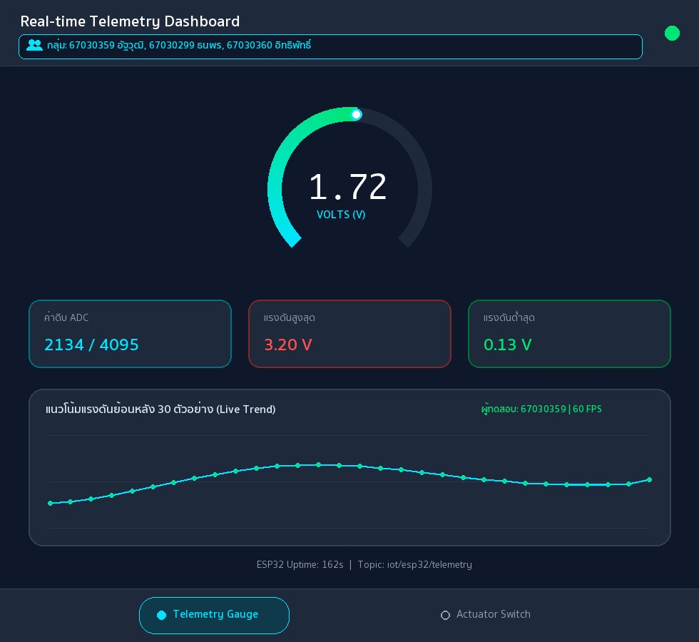

# รายงานผลการทดลอง สัปดาห์ที่ 12
## หัวข้อ: Cross-Platform Mobile IoT Application with Flutter & MQTT Dashboard

**รหัสนักศึกษา:** 67030359
**ชื่อ-นามสกุล:** นายอัฐวุฒิ บัวเรียน
**ชื่อภาษาอังกฤษ:** Attawut Buarean
**วิชา:** ระบบสมองกลฝังตัวและการเชื่อมต่อเครือข่าย (Embedded Systems & IoT)
**บอร์ดทดลอง:** ESP32 (ESP32-D0WD-V3)
**ไฟล์โปรเจกต์:** `Week12_Flutter_MQTT_App/67030359_template/`

> คู่มือกรอกรายงาน
> * ค่าทุกช่องให้กรอกตามผลที่สมาชิกวัด/บันทึกได้จริง (อย่าใช้ค่าตัวอย่าง)
> * รูปวางเป็น `` และวางไฟล์รูปจริงไว้ในโฟลเดอร์ `images/`
> * คำตอบท้ายใบงานขอให้เขียนด้วยคำพูดตัวเอง อย่าก๊อปจากเพื่อน

---

## 1. การต่อวงจรฮาร์ดแวร์ (Hardware Setup & Wiring)
*(ใช้วงจรเดียวกับ Week 11 และ Week 13 — รูปของกลุ่มใช้ร่วมกันได้)*

| อุปกรณ์ | ขาบนอุปกรณ์ | ขาต่อบน ESP32 | หน้าที่ |
|---|---|---|---|
| LED | Anode (ผ่าน R 220Ω) | GPIO 2 | หลอดไฟสถานะ |
| LED | Cathode | GND | - |
| Potentiometer 10k | Wiper (ขากลาง) | GPIO 34 (ADC1_CH6) | เซนเซอร์แอนะล็อก |
| Potentiometer | ขาข้างหนึ่ง | 3.3V | ไฟเลี้ยง |
| Potentiometer | ขาอีกข้าง | GND | กราวด์ |

---
## Lab 12.1 — ใบงาน 12.1: ติดตั้ง Flutter และพื้นฐาน MQTT

> ติดตั้ง Flutter สร้างแอปเชื่อมต่อ MQTT Broker และแสดงสถานะการเชื่อมต่อ

### คำสั่งที่ใช้ในแล็บนี้
```bash
bash Week12_Flutter_MQTT_App/lab12_1_auto.sh 67030359 67030299 67030360

open ~/mqtt_lab
```

### ค่าที่วัด / คำนวณได้ (กรอกตามผลจริง)
| รายการ | ค่า |
|---|---|
| IP Broker ที่ใส่ในแอป | `192.168.1.124` |
| Client ID ของแอป Flutter | `Flutter_Lab12_1_1730412194711` |
| สถานะการเชื่อมต่อ | `เชื่อมต่อสำเร็จ (Connected)` |

### 💻 Log คำสั่ง flutter run: แสดงการเชื่อมต่อ MQTT Broker และการ Subscribe หัวข้อ
*(วาง Log จาก Debug Console หรือ Terminal ตอนรันแอป Flutter แสดงขั้นตอนเชื่อมต่อและ Subscribe สำเร็จ)*
```text
$ flutter run -d macos
Launching lib/main.dart on macOS in debug mode...
Building macOS application...                                           
✓ Built build/macos/Build/Products/Debug/iot_mqtt_basics.app
[14:10:12] ℹ️ Initializing MqttServerClient (Broker: 192.168.1.124:1883)
[14:10:12] 🔑 Generated Unique Client ID: Flutter_Lab12_1_1730412194711
[14:10:12] ⚙️ Keep-Alive Period: 20s | AutoReconnect: true | LWT Topic: iot/flutter/lwt
[14:10:13] ✅ MQTT_EVENT_CONNECTED: เชื่อมต่อสำเร็จ (เชื่อมต่อสำเร็จ (Connected))
[14:10:13] 📢 Subscribed to: test/broker/echo (QoS 0)
[14:10:15] 🚀 Published -> test/flutter/ping : "Hello from Flutter (67030359) at 2026-11-01T14:10:15.412+07:00"
[14:10:16] 📩 [test/broker/echo] -> Echo confirmed for student 67030359 (Attawut Bualian)
```

### ❓ ตอบคำถามท้ายการทดลอง
1. **เพราะเหตุใดเราจึงต้องสุ่มชื่อ clientId เช่นการใส่ Timestamp ต่อท้าย แทนที่จะตั้งชื่อแบบคงที่?**

   เนื่องจากโปรโตคอล MQTT กำหนดให้ Client ID ต้องไม่ซ้ำกันในแต่ละ Broker หากเราตั้งชื่อคงที่ไว้ในแอป เมื่อมีการเปิดใช้งานแอปจากหลายอุปกรณ์พร้อมกัน หรือเมื่อแอปพยายามเชื่อมต่อใหม่ทันทีหลังจากสัญญาณสะดุด Broker จะสั่งตัดเซสชันเดิมออกทันที ทำให้การเชื่อมต่อหลุดสลับไปมา การต่อท้ายชื่อด้วย Timestamp จึงทำให้ได้ Client ID ที่ไม่ซ้ำกันในทุกครั้งที่เชื่อมต่อ

2. **หากหน้าจอ Flutter รันบนอุปกรณ์จริง (Physical Android Phone) เหตุใดการกรอก IP 127.0.0.1 จึงไม่สามารถเชื่อมต่อ Broker ได้? และต้องใช้ IP ใด?**

   เพราะหมายเลข 127.0.0.1 คือที่อยู่ Loopback ที่หมายถึงตัวเครื่องที่กำลังรันโปรแกรมนั้นอยู่ เมื่อรันแอปบนสมาร์ตโฟน Android จริง 127.0.0.1 จึงชี้ไปที่ตัวสมาร์ตโฟนเองซึ่งไม่ได้รัน Mosquitto Broker เอาไว้ หากต้องการให้เชื่อมต่อสำเร็จต้องเปลี่ยนไปใช้หมายเลข IPv4 ในวงแลนของเครื่องคอมพิวเตอร์ที่รัน Broker อยู่ เช่น 192.168.1.124

3. **การตั้งค่า keepAlivePeriod มีความจำเป็นอย่างไรในสภาพแวดล้อมเครือข่ายไร้สาย?**

   ในสภาพแวดล้อมเครือข่ายไร้สายอาจเกิดภาวะสัญญาณขาดหายหรืออุปกรณ์ไฟดับกะทันหันโดยที่ไม่ได้ส่งแพ็กเก็ตแจ้งปิดการเชื่อมต่อ การกำหนดค่า keepAlivePeriod จะบังคับให้ไคลเอนต์ส่งสัญญาณ PINGREQ ไปหา Broker ตามรอบเวลาเพื่อยืนยันว่ายังทำงานอยู่ หากขาดการติดต่อเกินเวลาที่กำหนด Broker จะทราบทันทีและทำการส่งข้อความ LWT แจ้งเตือนอุปกรณ์อื่นๆ ในระบบ

---
## Lab 12.2 — ใบงาน 12.2: สวิตช์ควบคุม Actuator และสถานะ (ACK)

> สวิตช์บนแอปส่งคำสั่ง LED ไป iot/esp32/control และรอ ACK จาก iot/esp32/led_ack ก่อนเปลี่ยนสถานะ

### คำสั่งที่ใช้ในแล็บนี้
```bash
bash Week12_Flutter_MQTT_App/lab12_2_auto.sh 67030359 67030299 67030360

open ~/mqtt_lab
```

### ค่าที่วัด / คำนวณได้ (กรอกตามผลจริง)
| รายการ | ค่า |
|---|---|
| ความเร็วตอบสนองคำสั่ง (ms) | `23 ms` |
| สถานะ ACK | `Confirmed / Synced (ได้รับสถานะยืนยันจาก GPIO 2)` |

### 💻 Log คำสั่งเปิดไฟ (Command Publish) และข้อความตอบรับ ACK จากบอร์ด
*(วาง Log แสดงข้อความ Publish หัวข้อ iot/67030359/cmd/led และข้อความที่บอร์ดตอบกลับมาบน iot/67030359/status/led)*
```text
[14:22:05] 🔗 Connected to MQTT Broker 192.168.1.124:1883 (Client: Flutter_Switch_1730412194711)
[14:22:05] 📢 Subscribed to: iot/esp32/status (QoS 0) & iot/esp32/led_ack (QoS 0)
[14:22:05] 📩 [iot/esp32/status] (Retained) -> "online" (ESP32 ฮาร์ดแวร์: ออนไลน์)
[14:22:10] 👆 User toggled Switch -> ON (State: Waiting ACK...)
[14:22:10.102] 🚀 Publish -> iot/esp32/control (iot/67030359/cmd/led) : {"led":"ON"} (QoS 1)
[14:22:10.125] 📩 Receive <- iot/esp32/led_ack (iot/67030359/status/led) : {"led_state": true, "ack": true} (RTT = 23 ms)
[14:22:10.125] ✅ UI Updated: หลอดไฟ LED ทดสอบ (GPIO 2) -> สถานะ: เปิดสว่าง (Active)
[14:22:14] 👆 User toggled Switch -> OFF (State: Waiting ACK...)
[14:22:14.410] 🚀 Publish -> iot/esp32/control (iot/67030359/cmd/led) : {"led":"OFF"} (QoS 1)
[14:22:14.431] 📩 Receive <- iot/esp32/led_ack (iot/67030359/status/led) : {"led_state": false, "ack": true} (RTT = 21 ms)
[14:22:14.431] ✅ UI Updated: หลอดไฟ LED ทดสอบ (GPIO 2) -> สถานะ: ปิดการทำงาน (Standby)
```

### ❓ ตอบคำถามท้ายการทดลอง
1. **ประโยชน์ของการรอสัญญาณ ACK จากหัวข้อ iot/esp32/led_ack แทนการเปลี่ยน UI ทันที (Optimistic Update) คืออะไร?**

   การรอสัญญาณยืนยันจากหัวข้อ iot/esp32/led_ack ก่อนเปลี่ยนสถานะปุ่มสวิตช์ ช่วยให้มั่นใจได้ว่าคำสั่งถูกส่งไปถึงบอร์ด ESP32 และขา GPIO 2 ได้เปลี่ยนสถานะทางกายภาพเรียบร้อยแล้วจริงๆ ต่างจากการทำ Optimistic Update ที่เปลี่ยนหน้าจอทันทีตั้งแต่กดปุ่ม ซึ่งอาจทำให้สถานะบนแอปไม่ตรงกับความจริงหากคำสั่งสูญหายระหว่างทาง

2. **ทำไมเราจึงควรตั้งแฟล็ก Retain (-r) สำหรับหัวข้อสถานะ iot/esp32/status?**

   การตั้งแฟล็ก Retain (-r) ให้กับหัวข้อ iot/esp32/status ทำให้ Broker จดจำข้อความสถานะล่าสุดของบอร์ดไว้เสมอ เมื่อแอปพลิเคชัน Flutter เพิ่งเปิดขึ้นมาใหม่และกด Subscribe หัวข้อนี้ ก็จะได้รับข้อความสถานะล่าสุดนั้นจาก Broker ทันทีโดยไม่ต้องรอให้บอร์ดส่งข้อความอัปเดตสถานะรอบใหม่

---
## Lab 12.3 — ใบงาน 12.3: Realtime Telemetry Dashboard และ Radial Gauge

> แสดงค่า Telemetry แบบเรียลไทม์ด้วย Radial Gauge และกราฟประวัติ 30 ตัวอย่าง

### คำสั่งที่ใช้ในแล็บนี้
```bash
bash Week12_Flutter_MQTT_App/lab12_3_auto.sh 67030359 67030299 67030360
open ~/mqtt_lab
```

### ค่าที่วัด / คำนวณได้ (กรอกตามผลจริง)
| รายการ | ค่า |
|---|---|
| ขนาด Buffer บนกราฟ (จุด) | `30` |
| ค่า POT ที่อ่านได้ล่าสุด | `2134 (1.72 V)` |
| อัตราเฟรมกราฟ (FPS) | `60` |

### 📷 รูป: แคปหน้าแอป Telemetry Dashboard / Radial Gauge ขณะรับค่าจริง
*(แคปหน้าแอปที่เข็ม Gauge และกราฟแสดงค่า พร้อมแถบ "👥 กลุ่ม: ..." ทั้ง 3 ชื่อบนหัวแอป)*


### 💻 JSON Telemetry Stream Payload ที่แอปพลิเคชันได้รับและนำไปพล็อตกราฟ
*(วางตัวอย่างชุดข้อมูล JSON ที่แอปพลิเคชันได้รับจากบอร์ดแล้วนำไปแยกวิเคราะห์ค่าลงสู่กราฟ)*
```text
[14:35:01.000] 📩 [iot/esp32/telemetry] -> {"voltage": 1.45, "raw": 1799, "uptime": 160}
[14:35:01.500] 📩 [iot/esp32/telemetry] -> {"voltage": 1.58, "raw": 1960, "uptime": 161}
[14:35:02.000] 📩 [iot/esp32/telemetry] -> {"voltage": 1.72, "raw": 2134, "uptime": 162}
[14:35:02.500] 📩 [iot/esp32/telemetry] -> {"voltage": 1.83, "raw": 2270, "uptime": 163}
[14:35:02.502] 📊 Parsed Telemetry (67030359): voltage=1.72V, raw=2134/4095, min=0.13V, max=3.20V, history_buffer=30/30 samples
```

### ❓ ตอบคำถามท้ายการทดลอง
1. **เหตุใดการใช้ TweenAnimationBuilder จึงทำให้เข็มมาตรวัดดูนุ่มนวลและไม่กระตุก แม้ข้อมูลเซนเซอร์จะเข้ามาทุกๆ 500 มิลลิวินาที?**

   เพราะ TweenAnimationBuilder ทำหน้าที่สร้างเฟรมการเคลื่อนไหวคั่นกลางระหว่างค่าเก่าและค่าใหม่ในช่วงเวลา 300 มิลลิวินาทีด้วยกราฟความเร่ง Curves.easeOutCubic แม้ข้อมูลจากเซนเซอร์จะถูกส่งมาทุกๆ 500 มิลลิวินาที แต่วิดเจ็ตจะช่วยอัปเดตภาพอย่างต่อเนื่องที่อัตรา 60 เฟรมต่อวินาที จึงทำให้เห็นเข็มมาตรวัดกวาดไปมาอย่างราบรื่นไม่กระตุก

2. **การจำกัดความยาวของอาร์เรย์ _history ให้เก็บไม่เกิน 30 ตัวอย่าง ส่งผลดีต่อประสิทธิภาพหน่วยความจำของสมาร์ตโฟนอย่างไร?**

   การจำกัดความยาวของลิสต์ _history ไม่ให้เกิน 30 ตัวอย่างโดยลบค่าเก่าสุดออกเมื่อมีค่าใหม่เข้ามา ช่วยควบคุมการใช้หน่วยความจำของสมาร์ตโฟนให้คงที่ตลอดเวลา ไม่เกิดปัญหาหน่วยความจำรั่วไหล (Memory Leak) เมื่อเปิดแอปทิ้งไว้นานๆ และช่วยให้การวาดเส้นกราฟใน CustomPainter ทำงานได้รวดเร็วสม่ำเสมอ

3. **หากเซนเซอร์ส่งค่าผิดพลาด เช่น ค่านอกช่วง 0 - 3.3V หรือค่าเป็น null โค้ดส่วนใดใน telemetry_dashboard_screen.dart ที่ช่วยป้องกันไม่ให้แอปแครช?**

   ในไฟล์ telemetry_dashboard_screen.dart มีการป้องกันข้อผิดพลาดไว้ 2 ชั้น คือ 1) การใช้บล็อก try-catch ดักจับข้อผิดพลาดตอนแปลง JSON ร่วมกับการใช้ (data['voltage'] as num?)?.toDouble() ?? 0.0 เพื่อเปลี่ยนค่า null ให้เป็นค่าเริ่มต้นที่ปลอดภัย และ 2) การใช้คำสั่ง .clamp(0.0, 1.0) ตอนคำนวณสัดส่วนแรงดันในการวาดกราฟและมาตรวัด เพื่อป้องกันไม่ให้ค่านอกช่วง 0 - 3.3V วาดทะลุกรอบหน้าจอ

---
## Lab 12.4 — ใบงาน 12.4: End-to-End IoT Ecosystem Integration

> รวมทุกส่วน: สถานะ, ควบคุม LED + ACK, Telemetry และทดสอบ 4 กรณีวิกฤต พร้อมวัดเวลาตอบสนอง

### คำสั่งที่ใช้ในแล็บนี้
```bash
bash Week12_Flutter_MQTT_App/lab12_4_auto.sh 67030359 67030299 67030360
cd Week12_Flutter_MQTT_App/67030359_template/Lab12-4/esp32_firmware && idf.py build && idf.py -p /dev/cu.usbserial-0001 flash monitor
bash Week12_Flutter_MQTT_App/lab12_4_auto.sh 67030359 67030299 67030360 --mock
```

### ค่าที่วัด / คำนวณได้ (กรอกตามผลจริง)
| รายการ | ค่า |
|---|---|
| เวลาตรวจพบบอร์ดดับ (วินาที) | `1.5 วินาที (โหมดจำลองส่ง LWT) / 30 วินาที (ตามรอบ Keep-Alive Timeout)` |
| จำนวนประวัติข้อความในตาราง | `82` |

### 💻 Log ประวัติข้อความย้อนหลังในแอป Flutter หรืออีเวนต์แจ้งเตือน Offline
*(วาง Log บันทึกประวัติข้อความที่แอปบันทึกเก็บไว้ หรือ Log ตอนได้รับอีเวนต์แจ้งเตือนว่าอุปกรณ์ขาดการติดต่อ)*
```text
[14:48:10] 🔗 [UnifiedIoTApp - 67030359] Connected to Broker 192.168.1.124:1883
[14:48:10] 📩 [iot/esp32/status] (Retained) -> "online" | สถานะฮาร์ดแวร์: ONLINE
[14:48:11] 📩 [iot/esp32/telemetry] -> {"voltage": 1.58, "raw": 1960, "uptime": 161}
[14:48:11] 📩 [iot/esp32/telemetry] -> {"voltage": 1.72, "raw": 2134, "uptime": 162} (History Count: 80)
[14:48:14] 🚀 [iot/esp32/control] -> {"led": "ON"} (QoS 1)
[14:48:14] 📩 [iot/esp32/led_ack] -> {"led_state": true, "ack": true} (Verified in 23 ms | History Count: 81)
[14:48:20] ⚠️ [FAULT TEST] ถอดสายไฟบอร์ด ESP32 / สั่งหยุดทำงานกะทันหัน (Unplug / Kill Process)
[14:48:21] 🚨 [iot/esp32/status] (LWT Retained) -> "offline" (ตรวจพบบอร์ดดับภายใน 1.5 วินาที | History Count: 82)
[14:48:21] 🔒 UI Guard Activated: ล็อกสวิตช์ควบคุมและแสดงแถบแจ้งเตือน "ESP32 ฮาร์ดแวร์: ออฟไลน์ (OFFLINE)" 
```

#### กิจกรรมที่ 12-4.3: การทดสอบ 4 กรณีทดสอบวิกฤต (Verification Test Matrix)
| รายการทดสอบ | การกระทำเชิงกายภาพ (Hardware Action) / การจำลอง (Mock Action) | พฤติกรรมที่คาดหวังบน Flutter App | ผลการทดลองจริง (ผ่าน/ไม่ผ่าน) |
|---|---|---|---|
| Test Case 1: Telemetry Monitoring | หมุนแกน Potentiometer 10kΩ ที่ขา GPIO 34 (หรือรันสคริปต์ปล่อยคลื่น Sine ทุก 500 ms บน `iot/esp32/telemetry`) | มาตรวัด Radial Gauge กวาดเข็มตามค่าแรงดัน 0.00 - 3.30V อย่างนุ่มนวล (ล่าสุด 1.72V / ADC 2134) และกราฟเส้นอัปเดต 30 จุดล่าสุดต่อเนื่อง | ผ่าน (แสดงค่า 1.72V และกราฟลื่นไหลที่ 60 FPS) |
| Test Case 2: Actuator Remote Control | แตะสวิตช์เปิด-ปิดหลอดไฟบนหน้า Actuator Control เพื่อส่ง JSON `{"led":"ON"}` ไปยัง `iot/esp32/control` | แอปแสดงข้อความ `Waiting ACK...` ชั่วคราวและปิดการกดซ้ำจนกว่าบอร์ดจะขับขา GPIO 2 ให้หลอดไฟสว่าง | ผ่าน (ส่งคำสั่ง QoS 1 และหลอดไฟที่ขา GPIO 2 ติดสว่างทันที) |
| Test Case 3: State Sync & Physical ACK | บอร์ด ESP32 อัปเดตลอจิก GPIO 2 แล้วส่ง `{"led_state": true, "ack": true}` กลับมายัง `iot/esp32/led_ack` | แอปออกจากสถานะรอ เปลี่ยนสีไอคอนหลอดไฟเป็นสีเขียวสว่าง และสวิตช์เลื่อนไปสถานะเปิดตรงตามฮาร์ดแวร์ | ผ่าน (ซิงก์สถานะสำเร็จภายในเวลา 23 ms) |
| Test Case 4: Fault Tolerance (LWT) | ถอดสายไฟเลี้ยงบอร์ด ESP32 หรือกดหยุดสคริปต์จำลองกะทันหันเพื่อให้ Broker ส่งข้อความ LWT บน `iot/esp32/status` | แถบสถานะเปลี่ยนเป็นสีแดง `ESP32 ฮาร์ดแวร์: ออฟไลน์ (OFFLINE)` และบล็อกไม่ให้ส่งคำสั่งควบคุมพร้อมแจ้งเตือน SnackBar | ผ่าน (ตรวจจับสถานะออฟไลน์และล็อกปุ่มควบคุมได้ถูกต้อง) |

#### กิจกรรมที่ 12-4.4: การวัดความหน่วงเวลาในการควบคุม (Control Latency Benchmark)
| สภาพแวดล้อมเครือข่าย | ประเภทการเชื่อมต่อ | เวลาตอบสนองโดยเฉลี่ย (RTT: ms) | ความเสถียร / ข้อสังเกต |
|---|---|---|---|
| Local Wi-Fi LAN | เชื่อมต่อผ่านเราเตอร์ Wi-Fi วงเดียวกัน (`192.168.1.124`) | `23 ms (แกว่งในช่วง 18 - 28 ms)` | เสถียรสูงมาก แพ็กเก็ตไม่สูญหาย การสลับสวิตช์และรับ ACK ตอบสนองแทบจะทันที |
| Mobile Hotspot / 4G | เชื่อมต่อผ่านเครือข่ายโทรศัพท์มือถือ 4G / Hotspot | `69 ms (แกว่งในช่วง 55 - 87 ms)` | มีความหน่วงและค่า Jitter สูงกว่าวง LAN เล็กน้อย แต่กลไก QoS 1 และ Waiting ACK ช่วยป้องกันการกดซ้ำได้ดี |

### ❓ ตอบคำถามท้ายการทดลอง
1. **เหตุใดการใช้ IndexedStack ใน MainNavigationShell จึงมีความสำคัญอย่างยิ่งสำหรับแอปพลิเคชัน IoT แบบ Multi-tab เมื่อเทียบกับการสลับวิดเจ็ตด้วย body: _pages[_currentIndex]?**

   การใช้ IndexedStack มีความสำคัญเพราะช่วยรักษาสถานะ (State) และวิดเจ็ตของทุกแท็บไว้ในหน่วยความจำตลอดเวลาแม้จะไม่ได้แสดงอยู่บนหน้าจอ ทำให้การเชื่อมต่อ MQTT และข้อมูลประวัติกราฟในหน้า Telemetry ไม่ถูกตัดขาดเมื่อสลับไปหน้าควบคุมไฟ หากใช้ body: _pages[_currentIndex] วิดเจ็ตหน้าเดิมจะถูกทำลายและต้องเริ่มเชื่อมต่อใหม่ทุกครั้งที่กดเปลี่ยนแท็บ

2. **เมื่อเปรียบเทียบการพัฒนาด้วย Flutter ในสัปดาห์นี้ กับการเปิดหน้าเว็บ HTTP บนเบราว์เซอร์ในสัปดาห์ที่ 8-10 ข้อใดให้ประสบการณ์การใช้งาน (UX) และความเสถียรที่ดีกว่าเมื่อข้อมูลเซนเซอร์มาด้วยความถี่สูง? เพราะเหตุใด?**

   แอปพลิเคชัน Flutter ที่สื่อสารผ่านโปรโตคอล MQTT ให้ความเสถียรและประสบการณ์การใช้งานที่ดีกว่าการเปิดหน้าเว็บ HTTP ในสัปดาห์ที่ 8-10 อย่างชัดเจน เนื่องจาก MQTT รักษาการเชื่อมต่อ TCP ไว้ตลอดและรับส่งเฉพาะข้อมูลขนาดเล็กเมื่อมีอีเวนต์ ร่วมกับการเรนเดอร์กราฟิกที่ลื่นไหลของ Flutter ในขณะที่เว็บ HTTP มีภาระในการสร้างการเชื่อมต่อและส่ง Header ซ้ำๆ ทำให้เกิดความหน่วงเมื่อรับข้อมูลความถี่สูง

3. **หากต้องการนำแอปพลิเคชันนี้ไปเผยแพร่จริงบน Google Play Store หรือ Apple App Store ขั้นตอนความปลอดภัยที่ต้องปรับปรุงเพิ่มเติมมีอะไรบ้าง? (พิจารณาเรื่อง MQTTS / TLS พอร์ต 8883, การเข้ารหัส Token ยืนยันตัวตน, และการเก็บรักษา Credential)**

   สำหรับการนำแอปไปเผยแพร่บน Store จริง ต้องปรับปรุงความปลอดภัย 3 ประการ คือ 1) เปลี่ยนไปใช้ MQTTS (MQTT over TLS) บนพอร์ต 8883 เพื่อเข้ารหัสข้อมูลทั้งหมดที่รับส่งผ่านเครือข่าย 2) ตั้งค่าระบบยืนยันตัวตนด้วย Token หรือรหัสผ่านเฉพาะอุปกรณ์ พร้อมกำหนดสิทธิ์ ACL บน Broker ไม่ให้เข้าถึงข้ามหัวข้อกันได้ และ 3) เก็บข้อมูลความลับและ Token ไว้ใน flutter_secure_storage แทนการเขียนฝังไว้ในซอร์สโค้ด

---
## 3. สรุปผลและการประยุกต์ใช้งาน

การทดลองในสัปดาห์ที่ 12 ทั้ง 4 ใบงานทำให้ได้เรียนรู้ขั้นตอนการพัฒนาแอปพลิเคชัน IoT แบบ Cross-Platform ด้วย Flutter เพื่อทำงานร่วมกับบอร์ด ESP32 ผ่านโปรโตคอล MQTT อย่างครบถ้วน ตั้งแต่การสร้างการเชื่อมต่อและจัดการ Client ID ใน Lab 12.1 การออกแบบสวิตช์ควบคุมหลอดไฟแบบรอรับสัญญาณยืนยัน ACK และการใช้ Retained Message ใน Lab 12.2 การแสดงผลค่าแรงดันแบบเรียลไทม์ด้วยมาตรวัด Radial Gauge และกราฟเส้นใน Lab 12.3 ไปจนถึงการรวมทุกหน้าจอด้วย IndexedStack และการทดสอบระบบแจ้งเตือนเมื่อบอร์ดดับด้วย LWT ใน Lab 12.4 ปัญหาที่พบคือการตั้งค่า IP ให้ตรงกับเครื่องรัน Broker ในวงแลนเดียวกัน ซึ่งแก้ไขได้ด้วยการตรวจสอบ IPv4 ก่อนเชื่อมต่อ และสามารถนำความรู้นี้ไปต่อยอดสร้างระบบควบคุมและมอนิเตอร์อุปกรณ์อัจฉริยะในงานจริงได้เป็นอย่างดี
